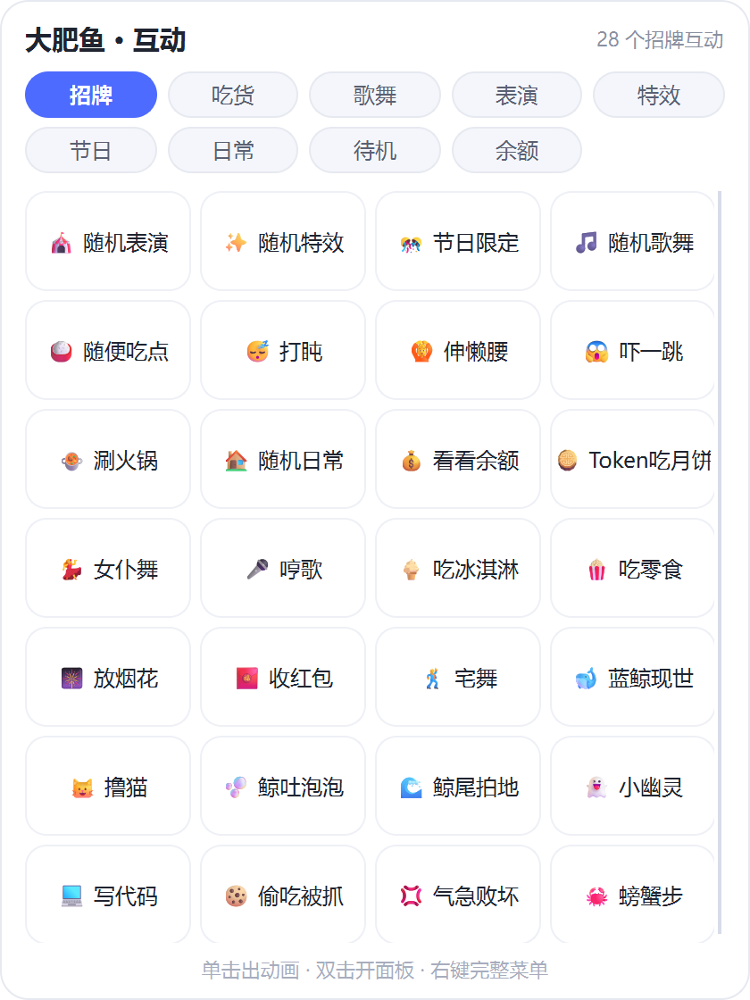
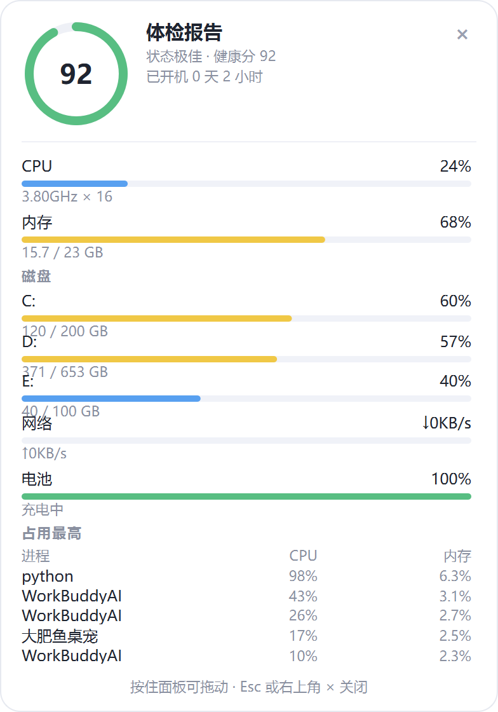
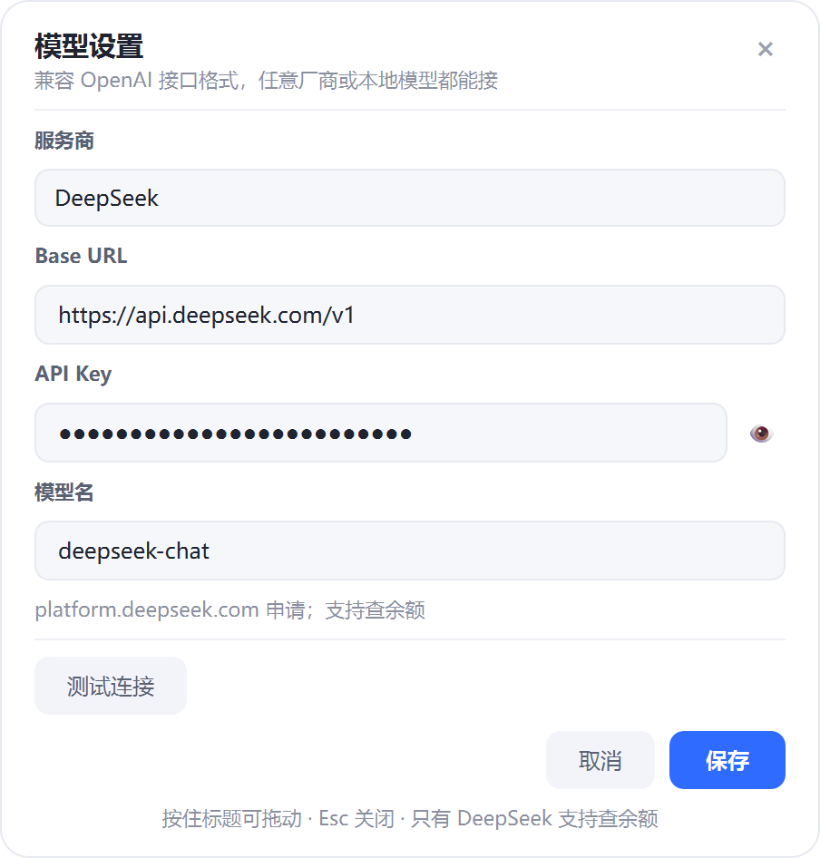
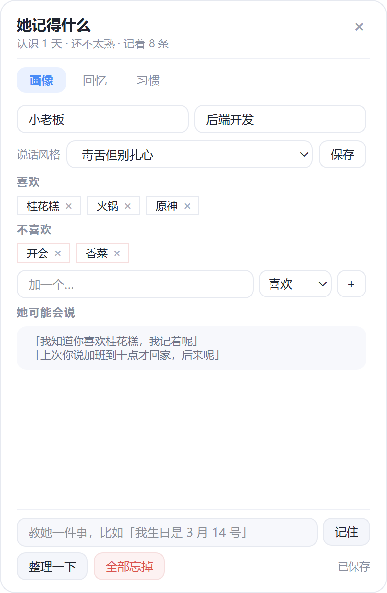
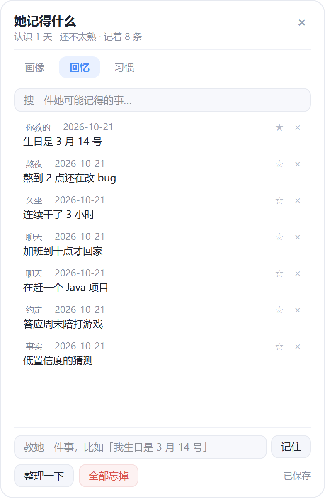
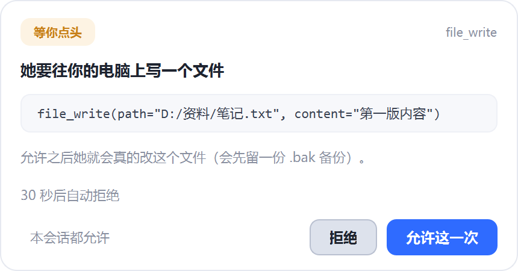

# 大肥鱼桌宠 🐋 · v2.0

> **本仓库是副本，不是原作者仓库。**
> 代码来自 [star211199/dafeiyu-pet](https://github.com/star211199/dafeiyu-pet)（作者 Albot），按 MIT 分发；
> 动画素材版权归 [dsh-pet](https://github.com/PC2005-cloud/dsh-pet)（PC2005-cloud）所有，**仅限非商用**。
> 详见 [NOTICE](NOTICE) 与 [LICENSE](LICENSE)。下载、提 issue、更新请优先去上游仓库。

一只陪你摸鱼的 DeepSeek 鲸鱼娘桌宠。透明无边框、置顶、可拖拽，**默认只在屏幕右下角小范围活动，不挡你办公**。

**Not just a pet.** v2.0 起她开始记事，也开始能帮你动手。

- **100 段透明动画**（VP9 alpha 视频，640×360 / 24fps）
- **28 个招牌互动** + 完整动作点播
- **她记得你**：记住你的喜好、承诺、作息，并在合适的时候提起（本地存储，随时可删）
- **她能帮你动手**：23 个工具 + 受限代码执行，能整理文件、开程序、调音量、截图 —— 动手前先问，`Ctrl+Alt+Q` 随时叫停
- **电脑体检**：CPU / 内存 / 显卡 / 磁盘 / 网络 / 电池 / 进程
- **AI 聊天**：任意兼容 OpenAI 接口的模型 —— DeepSeek / OpenAI / 通义 / Kimi / 智谱 / Ollama 本地都能接
- **节日自动感知**：农历节日用预生成表，当天会主动过节
- **手机版（实验）**：Flutter 重写的 Android 版，聊天 / 记忆 / 画中画都已可用，见 [手机版](#手机版实验)

**仓库**：[Gitee](https://gitee.com/albot-crane/dafeiyu-pet) · [GitHub](https://github.com/star211199/dafeiyu-pet)

**直接玩（不用装 Python）**：

| 下载 | 说明 |
|------|------|
| [GitHub Releases](https://github.com/star211199/dafeiyu-pet/releases/tag/v2.0) | 一个 zip 搞定，125MB |
| [Gitee Releases](https://gitee.com/albot-crane/dafeiyu-pet/releases/tag/v2.0) | 拆成 `part1` / `part2` 两卷（Gitee 附件单文件限 100MB），**两个都下载，解压到同一个文件夹** |

---

## 看一眼

<p align="center">
  
</p>

<p align="center">
  
  
</p>

<p align="center">
  
</p>

---

## 怎么玩

| 操作 | 效果 |
|------|------|
| **左键单击** | 随机一个点击反应动画 + 气泡台词 |
| **左键双击** | 打开互动面板（28 个招牌互动 + 100 个动作分类） |
| **按住拖拽** | 拖着走，松手会「啪叽」落地，活动范围跟着落点走 |
| 右键 | 完整菜单（动作点播 / 体检 / 聊天 / 模型设置 / 模式 / 大小 / 设置） |
| **托盘图标** | 单击显示隐藏，右键同款菜单 |

### 弹出窗口怎么关、怎么拖

| 窗口 | 特性 |
|------|------|
| **互动面板**（双击鱼） | `Qt.Popup` 弹层，点外面或按 Esc 自动收起 |
| **体检报告**（右键菜单） | 独立窗口：右上角 `×`、`Esc`、菜单项「✖ 关闭体检报告」三种关法；按住面板任意位置（包括指标条、文字）都能拖动，拖出屏幕会自动吸回 |

> 无边框 `Qt.Tool` 窗口不会自己处理拖动和 Esc，必须显式实现。体检面板的拖动靠
> `eventFilter` 接管子控件的鼠标事件 —— 注意过滤器里 **不能 return True**，
> 否则 Qt 不会建立鼠标 grab，表现就是「拖一下就断」。

鱼身以外的透明区域**鼠标可以穿透**（靠 `WM_NCHITTEST` 按像素 alpha 判定），
所以窗口虽然有一大块，但不会挡住你点下面的东西。

---

## 28 个招牌互动

| | | | |
|---|---|---|---|
| 🎪 随机表演 | ✨ 随机特效 | 🎊 节日限定 | 🎵 随机歌舞 |
| 🍚 随便吃点 | 😴 打盹 | 🙆 伸懒腰 | 😱 吓一跳 |
| 🍲 涮火锅 | 🏠 随机日常 | 💰 看看余额 | 🥮 Token吃月饼 |
| 💃 女仆舞 | 🎤 哼歌 | 🍦 吃冰淇淋 | 🍿 吃零食 |
| 🎆 放烟花 | 🧧 收红包 | 🕺 宅舞 | 🐋 蓝鲸现世 |
| 🐱 撸猫 | 🫧 鲸吐泡泡 | 🌊 鲸尾拍地 | 👻 小幽灵 |
| 💻 写代码 | 🍪 偷吃被抓 | 💢 气急败坏 | 🦀 螃蟹步 |

其中「随机表演 / 随机特效 / 节日限定 / 随机歌舞 / 随便吃点 / 随机日常」是从对应分类里按权重随机；
「看看余额」会真的去查 DeepSeek 账户余额（需要设置 Key）；
「Token吃月饼」会在月饼上撒金币并报一个 token 数。

---

## 完整动作库（100 个）

| 分类 | 数量 | 举例 |
|------|------|------|
| 待机 | 2 | 待机、打盹 |
| 日常 | 16 | 写代码、撸猫、偷吃被抓、气急败坏、照镜子、刷牙、换衣服 |
| 吃货 | 20 | 涮火锅、吃冰淇淋、吃零食、吃饺子、吃青团、吃汤圆、嗦面、吃粽子 |
| 节日 | 14 | 放烟花、收红包、吃月饼、舞狮、写福字、堆雪人、圣诞树、万圣南瓜、放天灯、放河灯 |
| 表演 | 14 | 扑克魔术、变鸽子、变花、吹气球、抛接球、放风筝、踢毽子、下五子棋、玩魔方 |
| 歌舞 | 7 | 女仆舞、宅舞、哼歌、摇摆舞、女仆行礼、吹笛子、拉小提琴 |
| 特效 | 7 | 蓝鲸现世、鲸吐泡泡、鲸尾拍地、小幽灵、兽耳光环、蝶舞光环、落叶堆 |
| 碎碎念 | 4 | 碎碎念、沉思、擦擦脸、盯屏幕 |
| 余额 | 6 | 余额空空、余额告急、金币叮当、余额爆表、余额正常、数钱 |
| 点击反应 | 5 | 挥手、开心、生气、害羞、偷笑 |

---

## 电脑体检

右键 → 体检报告，或者互动面板外的菜单入口。面板每秒刷新：

- **综合健康分**（0-100 环形图）+ 一句人话结论
- **CPU**：占用率 / 主频 / 线程数 / 温度（能读到才显示）
- **内存**：占用率 + 已用/总量
- **显卡**：占用 / 温度 / 显存（NVIDIA 走 NVML，没有就自动隐藏）
- **磁盘**：每个分区的占用
- **网络**：实时上下行速率
- **电池**：电量 + 充电状态
- **占用最高**：CPU 与内存 Top5 进程

超阈值会主动冒泡提醒（CPU ≥90%、内存 ≥92%、显卡 ≥82°C、CPU ≥88°C、磁盘 ≥93%、电量 ≤15%），
同一项不会反复刷屏，回落之后才会再次触发。

---

## AI 聊天 / 天气 / 余额

**不绑定厂商**：任何兼容 OpenAI `chat/completions` 接口的服务都能接，只要三样东西 ——
`base_url`、`api_key`、`model`。

右键 → 设置 → **🤖 模型设置**，面板里填这三格，点「测试连接」验证，绿字通了再保存。

<p align="center">
  
</p>

内置预设（选完仍可随手改）：

| 服务商 | Base URL | 模型名示例 |
|--------|----------|-----------|
| DeepSeek | `https://api.deepseek.com/v1` | `deepseek-chat` |
| OpenAI | `https://api.openai.com/v1` | `gpt-4o-mini` |
| 通义千问 | `https://dashscope.aliyuncs.com/compatible-mode/v1` | `qwen-plus` |
| Kimi | `https://api.moonshot.cn/v1` | `moonshot-v1-8k` |
| 智谱 GLM | `https://open.bigmodel.cn/api/paas/v4` | `glm-4-flash` |
| 硅基流动 | `https://api.siliconflow.cn/v1` | `Qwen/Qwen2.5-7B-Instruct` |
| Ollama（本地） | `http://localhost:11434/v1` | `qwen2.5:7b` |
| LM Studio（本地） | `http://localhost:1234/v1` | 随便填 |
| vLLM / 自建 | `http://localhost:8000/v1` | 看你的部署 |

此外任何 one-api / new-api 之类的中转站，填它给的那条地址就行。

**Base URL 的容错**：这些写法都认，会自动补成标准形式

```
api.deepseek.com                      -> https://api.deepseek.com/v1
https://api.openai.com                -> https://api.openai.com/v1
https://api.openai.com/v1/            -> https://api.openai.com/v1
https://api.openai.com/v1/chat/completions -> https://api.openai.com/v1
localhost:11434                       -> http://localhost:11434/v1   （本机自动用 http）
```

**本地模型不用 Key**：地址是 `localhost` / `127.0.0.1` / 局域网段时，Key 可以留空。

**报错会翻译成人话**，不用自己对着状态码猜：

| 情况 | 冒泡说 |
|------|--------|
| 401 | Key 不对或没权限 |
| 404 | 接口地址不对，检查 Base URL |
| 400 + model not exist | 模型名不对，检查 model |
| 429 | 请求太频繁，等下再说 |
| 5xx | 服务端抽风了（503） |
| 返回格式不是 OpenAI | 返回格式看不懂，确认是 OpenAI 接口 |

**模型兼容性**：有些推理模型不收 `temperature` / `max_tokens`。
遇到 400 报这两个参数时，会自动去掉 `temperature`、把 `max_tokens` 换成
`max_completion_tokens` 重试一次，不用手动改。

其他：

- **聊天**：右键「跟她说句话」；保留最近 40 条上下文；超 40 字自动截断成一句气泡
- **余额**：只有 DeepSeek 有这套接口，别的厂商会直接说「这个接口查不了余额」
- **天气**：`wttr.in`，城市在设置里改

Key 存在 `%APPDATA%\DafeiyuPet\config.json`，不会进仓库（`.gitignore` 已排除）。
老版本的 `ds_api_key` 会自动迁移到新的 `llm_api_key`，不用重新填。

---

## 她记得你

她不是每次都从零开始的。聊过的事、你的口味、作息、答应过的话，都会慢慢攒下来，
然后在合适的时候冒出来一句——不是复读，是"你那个冰美式今天没喝？"这种。

右键 → **🧠 她记得什么**，三页：

| 页 | 内容 |
|----|------|
| **画像** | 称呼、职业、说话风格、喜欢/讨厌/习惯（chip 云，点 × 可删） |
| **回忆** | 事件、承诺、深夜加班这类情景记忆；可置顶（置顶永不过期） |
| **习惯** | 最近 7 天的活跃时段柱状图 + 观察到的规律 |

画像页底部还有「她可能会说」预览——**你随时能看到她准备拿哪句话来搭话**，
不满意就删掉那条记忆。

<p align="center">
  
  
</p>

**记忆的边界（写在代码里的，不是承诺）：**

- 只记**聊天内容**和**系统指标**（CPU/内存/活跃时段）。**不读窗口标题、不读进程名、不截屏。**
- 一切都在本地 `%APPDATA%\DafeiyuPet\memory.json`，不上传。
- 设置里两个开关：`记住聊天内容` / `记录使用习惯`，随时关，关了立即停。
- 「全部忘掉」是两步确认（第一次上膛，4 秒内再点一次才真删）。

**人格化台词有三条防恐怖谷的硬约束**（`app/memory/voice.py` 里写死的常量）：
记忆台词只占 35%，其余走原台词库；负面记忆（熬夜、久坐）亲密度不到 60 不许提；
23:30–04:00 才认"深夜"。这三条不加的话，她会变成那种一天问八遍"你今天还好吗"的亲戚。

---

## 她能帮你动手（Agent）

右键 → **🛠 让她帮我干点活…**，说一句话，她真的去做：翻文件、按规则整理、
写文件、启动程序、切窗口、调音量亮度、截屏存盘、读剪贴板。

**默认是关的。** 第一次用会弹一个知情页，必须勾选「我知道她能读写文件、启动程序」
才能点确定——不是点一下"同意"就过去。

<p align="center">
  
</p>

**三级风险，默认拒绝：**

| 等级 | 例子 | 行为 |
|------|------|------|
| SAFE | 看系统信息、读工作区文件、调音量、冒泡说话 | 不问，只记日志 |
| CONFIRM | 写文件、启动程序、切窗口、读剪贴板、截屏 | 每次弹窗问；**默认焦点在「拒绝」**，回车=拒绝，Esc=拒绝，30 秒没人管自动拒 |
| DANGER | 白名单外路径、进程列表（未开开关时） | 直接拒，**永远不给"本会话都允许"这个选项** |

**急停：`Ctrl+Alt+Q`**（被占用时退到 `Ctrl+Alt+F12`）。
用的是 `RegisterHotKey` 而不是 `QShortcut`——因为 Agent 恰恰是在你去干别的、
应用没有焦点的时候跑，`QShortcut` 那时候根本收不到键。任务面板上也有一个红色的
「让她停下」。

**工作区**：`%APPDATA%\DafeiyuPet\agent_workspace`，外加桌面 / 文档 / 下载。
`config.json`（有你的 API Key）、`memory.json`、`C:\Windows`、`C:\Program Files`
永久拒绝。写文件会先留三代 `.bak`，写完**读回来比对**。

### 丑话（原样写在 `sandbox.py` 里，这里照抄）

它不是沙箱，是**受限执行环境**。CPython 里没有安全沙箱，这是业界共识。
威胁模型是「防模型手滑」，不是「防恶意逃逸」。它**挡不住**：

1. 专门构造的逃逸链（builtins 白名单仍有组合空间）
2. C 层阻塞（COM 卡死只能重启桌宠）
3. 白名单工具造成的真实破坏（覆盖的是真文件）
4. 数据外流（工具返回值会发往云端模型——所以进程列表默认禁用、截图永不进上下文）
5. 内存炸弹（`[0] * 10**9` 会直接把进程撑死）
6. 提示注入（文件里写「忽略之前的指令」，只能靠提示词约束 + 确认门降低概率）

**如果这六条里有任何一条你不能接受，就不要开这个功能。** 它默认就是关的。

### 它是怎么跑起来的

不是 function calling。中转站对 `tools` / `tool_choice` 的支持参差不齐，一半会直接 400。
这里用两个标签：`<intent>目的</intent>` + `<code>Python</code>`，代码在**持久解释器**
里执行，块与块之间共享变量（读到的内容下一步直接用，不用重读一遍）。

四条结构性防线，**不靠提示词劝**：

- **确认门挂在工具代理上**，不是挂在静态扫函数名上。模型把 `file_write` 赋给变量
  再调用，一样要过门。
- **账本里还有 `changed_unverified` 就不许 `finish`**。"回执 ok ≠ 办成"从提示词
  第 2 条规则变成一次真实的驳回（且只驳一次，不做成陷阱）。
- **`stop_event` 同时喂给沙箱检查点、`wait()`、每轮循环开头**。急停按下去最多再
  走完当前这一块。
- **日志只存代码的 sha + 200 字预览**，不存文件内容、剪贴板内容、窗口标题、API Key。

---

## 模式与大小

| 模式 | 说明 |
|------|------|
| **右下角活动**（默认） | 只在屏幕右下角一块区域里溜达（上限占屏 36%），不挡办公 |
| 全屏散步 | 整块屏幕随便走 |
| 跟随鼠标 | 鼠标跑远了就跟过去，靠近了就停下 |
| 原地待着 | 不动，只做小动作 |

大小四档：小 / 中 / 大 / 特大（相对 640×360 画布 0.50 / 0.70 / 0.90 / 1.10）。

---

## 运行（源码）

需要 **Python 3.11+**，Windows 10/11。

```bash
git clone https://gitee.com/albot-crane/dafeiyu-pet.git
cd dafeiyu-pet

python -m venv .venv
.venv\Scripts\pip install -r requirements.txt
.venv\Scripts\python main.py
```

> 仓库里已经带全部 100 段动画素材（约 50MB），clone 下来直接就能跑。
> GitHub 访问慢的话用 Gitee 那条地址，内容一致。

## 打包成 exe

```bash
.venv\Scripts\pyinstaller --noconfirm --clean 大肥鱼桌宠.spec
.venv\Scripts\python tools\prune.py dist\大肥鱼桌宠        # 瘦身 + 自检
```

产物在 `dist\大肥鱼桌宠\`，整个文件夹一起拷给别人即可，双击就能用，不需要装 Python。

**成品（235MB，含 100 段动画素材）不打进 git 仓库**，避免 clone 变慢。现成 exe 走 Releases：

- **GitHub**：`dafeiyu-pet-v2.0-win64.zip`，125MB，解压双击 `大肥鱼桌宠.exe`
- **Gitee**：`dafeiyu-pet-v2.0-win64-part1.zip`（62.6MB）+ `-part2.zip`（62.6MB），两个都要下，**都解压到同一个文件夹**（Windows 会提示「合并文件夹」，选是），再双击 `大肥鱼桌宠.exe`

> Gitee 的 Release 附件单文件上限 100MB，所以拆了卷。两卷都是**能独立解压的普通 zip**，
> 不是二进制分卷，不用敲 `copy /b` 合并；两卷文件不重叠，合起来就是完整的 `大肥鱼桌宠/` 目录。
> 只解压 part1 是跑不起来的，两个都要。

> 用目录形式而不是 `--onefile`：素材有 50MB，单文件每次启动都要解压一遍，会明显变慢。
> 杀毒软件可能对 PyInstaller 产物误报，加信任即可。
> `av.libs`（65MB）是 ffmpeg 的静态依赖，删了会 `ImportError: DLL load failed`，别动。

### 打包后的自检与诊断

| 命令 | 作用 |
|------|------|
| `大肥鱼桌宠.exe --selftest` | 素材齐全性、解码、系统监控、记忆模块、Agent 模块五组检查，结果写 `%TEMP%\dafeiyu_selftest.txt` |
| `大肥鱼桌宠.exe --agent-selftest` | Agent 全链路离线自检：路径白名单逃逸、三步任务、确认门拦截、允许后落盘、急停、日志、界面组件。**起本地假模型，不花钱不联网** |
| `大肥鱼桌宠.exe --probe` | 起窗口跑 3 秒，把几何/DPI/监控/自截图写到 `%TEMP%\dafeiyu_probe\` |
| `tools\click.py click\|dblclick\|rclick\|drag` | 用 Win32 消息模拟鼠标，做端到端交互测试 |
| `python tools\test_llm.py` | 起本地假 OpenAI 服务，跑完对话 / 各类报错 / 参数降级 / 余额共 14 项断言 |
| `tools\gdi_shot.py` | 纯 GDI 截屏（不建 QApplication，不会抢焦点导致面板自动隐藏） |
| `tools\wins.py` | 列出桌宠窗口的位置/尺寸/可见性 |

离线测试套件（`python tools\test_xxx.py`，共 508 项断言，全部不联网、不碰真实 Key）：

| 文件 | 断言 | 验什么 |
|------|------|--------|
| `test_agent_protocol.py` | 92 | `<intent><code>` 解析容错、AST 拒绝表、token 记账 |
| `test_agent_sandbox.py` | 69 | 持久解释器、超时打断、急停、输出截断、builtins 白名单 |
| `test_agent_tools.py` | 123 | **路径逃逸 8 例全拒**、LOLBins 全拒、备份轮转、确认门 |
| `test_agent_runner.py` | 108 | 三步完成、垃圾输出纠错、同代码 6 次停、预算超限、日志不含内容 |
| `check_agent_confirm.py` | 45 | 默认焦点在拒绝、Esc/超时=拒绝、DANGER 无会话放行 |
| `check_agent_ui.py` | 71 | 状态映射、进度 8 秒节流、结束 2 秒回 idle、Agent 缺失时降级 |

**真模型冒烟测试要手工做**（自检刻意不调真接口：花钱、不稳定、还要 Key）：
配好模型后连开三个任务，看日志里的 token 总量，成本应在 ¥0.5 以内——

1. 「看看工作区里有什么文件」→ 只读，不该弹确认窗
2. 「在工作区写个 todo.txt，写上今天三件事」→ 弹一次确认，允许后落盘
3. 「把音量调到 30」→ SAFE，直接执行

> 排查踩过的坑：桌宠用命名互斥量做单实例。**上一个实例没退干净时，新启动的 exe 只会弹一个「已经有一只大肥鱼」的提示框**，
> 看起来就像「exe 启动后什么都没有」。遇到这种情况先确认没有残留进程。

---

## 技术要点

**透明视频怎么播的。** 素材是 VP9 + 独立 alpha 平面的 webm（`ALPHA_MODE=1`）。
ffmpeg 默认的 vp9 解码路径会丢掉 alpha，必须显式用 `libvpx-vp9` 解码器上下文。
这里通过 PyAV 手动 demux + `CodecContext.create("libvpx-vp9", "r")` 解码，
实测 640×360 能跑到约 1000 fps（远高于 24fps 播放需求），
所以用「后台线程 + 有界队列预取 6 帧」的方式喂主线程，界面不卡。

**为什么不用逐帧图片。** 100 段 × 241 帧，转成 WebP 逐帧存要 300MB 左右；
直接放原始 webm 只有 50MB，画质还更好。

**透明区域鼠标穿透。** 处理 `WM_NCHITTEST`，按当前帧的 alpha 判断光标下是不是角色身体，
不是就返回 `HTTRANSPARENT` 让点击落到下面的窗口。
注意 Win32 消息给的是**物理像素**、Qt 用的是**逻辑像素**，高 DPI 下要按
`devicePixelRatio` 换算，否则 200% 缩放的屏幕上命中会整体偏一倍。

**农历节日。** 用 `lunardate` 离线生成 2020-2040 的节日对照表固化进代码，
运行时不依赖任何第三方库。

---

## 目录结构

```
dafeiyu_pet/
├── main.py                 入口（单实例、DPI、异常兜底、两种 selftest）
├── app/
│   ├── config.py           路径与配置（存 %APPDATA%）
│   ├── actions.py          100 个动作注册表 + 28 个招牌互动定义
│   ├── clip.py             VP9-alpha 解码播放器（线程 + 预取）
│   ├── pet.py              主窗口：播放 / 移动 / 交互 / 菜单 / 托盘
│   ├── effects.py          全屏粒子层（烟花 / 泡泡 / 雪花 / 爱心）
│   ├── sysmon.py           系统指标采集 + 阈值告警
│   ├── festival.py         公历 + 农历节日判定
│   ├── lines.py            台词库（可接人格化记忆层）
│   ├── llm.py              OpenAI 兼容接口：对话 / 余额 / 天气（不绑定厂商）
│   ├── llm_raw.py          裸补全 + token 估算（Agent 复用）
│   ├── memory/             记忆：schema / store / rules / extract / behavior / recall / voice / core
│   ├── agent/              电脑操作 Agent：
│   │   ├── protocol.py       <intent><code> 解析 + AST 静态校验
│   │   ├── prompts.py        系统提示 / 8 条硬规则 / 观察渲染
│   │   ├── llm.py            补全 + token 预算熔断
│   │   ├── sandbox.py        受限执行环境（合作式检查点 + builtins 白名单）
│   │   ├── tools.py          22 个工具 + 账本 2 个 + 路径白名单 + 风险分级
│   │   ├── win32.py          ctypes 封装（音量/亮度/窗口/剪贴板/截图/热键）
│   │   ├── gate.py           三级风险确认门
│   │   ├── runner.py         主循环 / 状态机
│   │   ├── todo.py           模型自维护的 todo 账本
│   │   ├── stall.py          原地打转检测
│   │   ├── context.py        两层上下文压缩
│   │   └── journal.py        jsonl 操作日志（只存代码指纹）
│   └── ui/                 互动面板、体检面板、模型设置、聊天输入框、记忆面板、
│                           确认窗 + 线程桥、任务面板、AgentBridge
├── assets/
│   ├── webm/               100 段透明动画
│   └── icon.png / .ico
├── flutter_app/            Android 版（Flutter），见下方"手机版"
├── docs/screenshots/       README 用截图
├── tools/                  图标生成、界面预览、素材处理、交互测试、离线测试套件
└── 大肥鱼桌宠.spec         PyInstaller 配置
```

---

## 手机版（实验）

`flutter_app/` 是用 Flutter 重写的 Android 版。PySide6 在手机上跑不起来，
所以 UI 全部重写、Win32 那部分能力丢弃，可复用的是动作注册表、记忆逻辑和交互手感。

**已经能用的**：100 段动画播放、单击 / 双击 / 拖动、AI 聊天、可配置任意
OpenAI 兼容模型、记忆（数据层 + 抽取 + 检索 + 面板）、画中画小窗、真退出、
手动调节大小。

**构建**：

```bash
cd flutter_app
python ../tools/sync_assets.py    # 补素材，见下
flutter build apk --release
```

**素材不在仓库里。** `flutter_app/assets/clips/` 的 100 段 webm 共 50MB，
是 `assets/webm/` 经 alpha 钳位后的派生物，故意没入库。
克隆后必须跑一次 `tools/sync_assets.py` 才有素材，否则 App 一启动就报
"本地素材服务启动失败"。脚本会自动选源：有 `build/clips/`（钳位版，
体积一半、手机上解码更快）就用它，没有就回退到 `assets/webm/`（原始版，
画面正常但边缘有一层薄雾）。

**本地调试不花 token**：`python tools/fake_llm_server.py` 起一个假服务，
配合 `adb reverse tcp:8899 tcp:8899`，App 里把 Base URL 填
`http://localhost:8899/v1`、Key 填 `test`、模型填 `fake`，
就能把"聊天 → 记忆抽取"整条链路跑通。服务端会打印每个请求带没带记忆块。

技术选型、踩过的坑和真机验收数据记在
[`docs/mobile-feature-plan.md`](docs/mobile-feature-plan.md)。

---

## 素材与致谢

- 动画素材来自开源项目 [dsh-pet](https://github.com/PC2005-cloud/dsh-pet)（作者 PC2005-cloud），**非商用**。
- 参考项目：[1190fasheqi/dafeiyu-pet](https://github.com/1190fasheqi/dafeiyu-pet)（三视图 + PySide6 实现思路）。
- 形象为 DeepSeek「鲸鱼娘 · 大肥鱼」二创，版权归原作者。

## 协议

- **代码**：MIT，版权归原作者 Albot（[star211199](https://github.com/star211199)），许可全文见 [LICENSE](LICENSE)。
- **动画素材**：版权归 [dsh-pet](https://github.com/PC2005-cloud/dsh-pet) 作者 PC2005-cloud，**仅限非商用**，不在 MIT 范围内。
- **角色形象**：DeepSeek「鲸鱼娘 · 大肥鱼」二创，版权归原作者／权利方，与本项目无官方关联。

本仓库只是副本，整体按「非商用」分发；商用请分别联系代码与素材的权利人。
许可边界的完整说明见 [NOTICE](NOTICE)。
